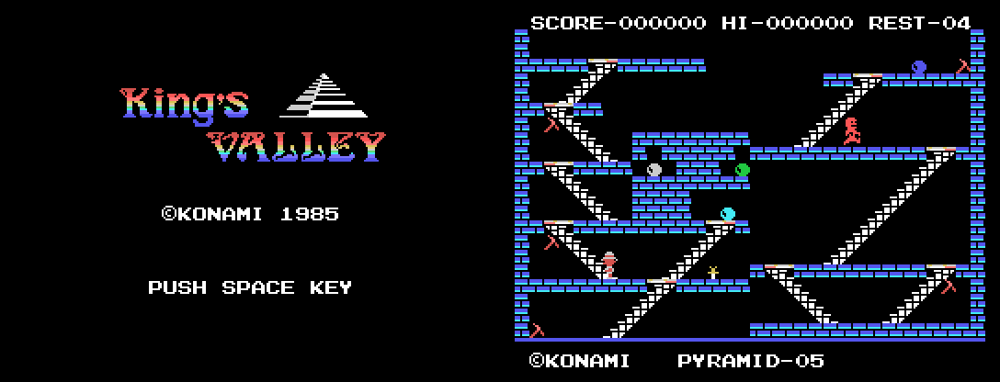

# go-msx-cryptexplorer

A native Go port of a 1985 MSX1 cartridge game. Each routine of the original
Z80 program is read, understood and rewritten as ordinary Go against a small
hardware-abstraction layer. **This is not an emulator: no Z80 code runs at
runtime.** An emulator is used only offline, as a reference to check the
port against the original tick by tick.

Status: the whole game is ported and playable. Recordings of the original
(attract mode, random play, and searched games clearing pyramids, through
the exit doors and the map screen into the next pyramid) match it byte for
byte, tick by tick; see `docs/analysis.md` for exactly what has been
verified.



## Requirements

- Go 1.27 or later
- Your own copy of the original cartridge ROM (16,384 bytes), placed in the
  repository root as:

  ```
  King's Valley 1 (1985) Konami [RC-727] [8553].rom
  ```

  SHA-256 `01bd3179540c886ab658626ca0460c329d167327fabd43eb615883375e9e9a3e`.
  Other dumps are not supported; the tools warn on a mismatch.
- For development only: openMSX with the bundled C-BIOS machines, used as an
  offline reference.

## Playing

```
go run ./cmd/extract     # once: rebuild the assets from your ROM
go run ./cmd/play
```

Arrows move (up and down climb stairs), SPACE jumps, or throws the dagger
or digs with the pick when you hold one. F1 pauses, F2 gives up the
current life, Esc quits. `-scale N` sets the window size, `-mute` turns
off the sound, and `-record file.keys` saves your session so it can be
replayed into the original and compared.

Cheat: on the title screen (or the logo or demo), a letter starts a game
at that pyramid: A at pyramid 1, B at pyramid 2, and so on to O at
pyramid 15 (there are 15). The cheat is an extension over the port: it
goes through the game's own start and only sets the pyramid (and its
entry door) before the first one is built. A recorded session notes it as
two RAM writes, which the reference recorder replays too.

## Legal

This is an unofficial, non-commercial fan project. It is not affiliated
with, authorised by or endorsed by the rights holder of the original game.

- The repository contains only source code written for this project. The
  engine executes no original program code.
- The original ROM, and any graphics, sound data, text or disassembly
  derived from it, are **not** distributed here. Assets are rebuilt locally
  from the ROM you supply.
- Rights holders with a concern are invited to open an issue.

See [NOTICE](NOTICE).
